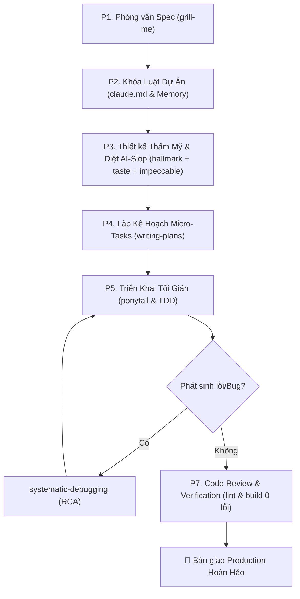

# 🎭 Master Orchestrator: Chu Trình Điều Phối Kỷ Luật Thép

Orchestrator này đóng vai trò là **Tổng Đạo Diễn & Tech Lead Trưởng**, xâu chuỗi tất cả các skills đơn lẻ trong dự án thành một dây chuyền sản xuất phần mềm khép kín, nhất quán, không lỗi và diệt trừ 100% AI-slop lẫn Code Bloat.

---

## 🧭 Ma Trận Phân Bổ Kỹ Năng (Skill Responsibility Matrix)

| Giai đoạn | Kỹ năng phụ trách | Vai trò cốt lõi | Output bắt buộc |
|---|---|---|---|
| **P1. Spec & Edge Cases** | `grill-me` + `brainstorming` | Phỏng vấn ngược, làm rõ mọi yêu cầu, ràng buộc và ca biên (edge-cases) | Bản đặc tả yêu cầu chi tiết (PRD/Spec) |
| **P2. Project Rules** | `claude.md` + `RECOMMENDED_SKILLS.md` | Ép tuân thủ luật kiến trúc dự án (Tech stack, cấu trúc thư mục, quy tắc cấm) | Cấu trúc file & dữ liệu chuẩn |
| **P3. UI/UX & Craft** | `hallmark` + `design-taste-frontend` + `impeccable` + `emil-design-eng` | Thiết kế giao diện đỉnh cao: diệt AI-slop, typography sắc sảo, micro-interactions mượt mà | Wireframe layout & Design tokens |
| **P4. Kế hoạch Micro-tasks**| `writing-plans` | Chia nhỏ công việc thành các bước 2–5 phút, rõ tiêu chí PASS | File Kế hoạch thực thi chi tiết |
| **P5. Tối giản mã nguồn** | `ponytail` + `test-driven-development` | Dùng React thuần + Native Web API, cấm over-engineering và cấm cài thêm package | Code tối giản, sạch, tự giải thích |
| **P6. Thực thi tuần tự** | `executing-plans` + `systematic-debugging` | Code lần lượt theo plan, khi có lỗi phải tìm Root Cause | Code hoàn thiện từng bước |
| **P7. Nghiệm thu & Review** | `code-review-and-quality` + `verification-before-completion` | Rà soát 5 trục chất lượng code, chạy `npm run lint` & `npm run build` | Báo cáo nghiệm thu 0 lỗi |

---

## 🔄 Quy Trình Vận Hành 7 Giai Đoạn (7-Phase Workflow)



---

### Giai đoạn 1: Khảo sát & Phỏng vấn ngược (`grill-me`)
- **Mục tiêu:** Không bao giờ đoán mò ý đồ người dùng.
- **Hành động của Orchestrator:**
  1. Phân tích đề bài người dùng đưa vào.
  2. Kích hoạt `grill-me`: Đặt các câu hỏi ngắn gọn, thực chất về:
     - Dữ liệu đầu vào, các trường hợp biên (số âm, danh sách rỗng, trùng lặp).
     - Hành vi khi bấm Lưu / Hủy / Sửa / Xóa.
     - Định dạng dữ liệu hiển thị (tiền, ngày, JSON).

---

### Giai đoạn 2: Khóa Luật Dự Án (Architecture Lock)
- **Mục tiêu:** Bảo vệ tính toàn vẹn của codebase, tránh Context Amnesia.
- **Hành động của Orchestrator:**
  1. Đọc và thực thi triệt để hướng dẫn trong `document/claude.md`.
  2. Xác định các ràng buộc cứng:
     - **Không cài thêm bất kỳ thư viện nào** (không redux, router, axios, lodash...).
     - Đúng cấu trúc 3 file: `data/BaiXX.json` ↔ `pages/BaiXX.jsx` ↔ `styles/BaiXX.css`.
     - Điều hướng hash qua `App.jsx`, selector CSS bắt buộc có tiền tố `.baiXX`.

---

### Giai đoạn 3: Thiết Kế UI/UX & Diệt AI-Slop (`hallmark`, `taste`, `impeccable`, `emil-design-eng`)
- **Mục tiêu:** Giao diện sắc sảo, thanh lịch, mang tinh thần sản phẩm thật.
- **Bộ lọc kiểm duyệt (Anti-AI-Slop Filter):**
  -  **Cấm:** Màu tím neon/gradient vô cớ, card lồng card thừa thãi, viền đậm lòe loẹt, chữ mờ khó đọc.
  -  **Chuẩn:**
     - `hallmark`: Phân cấp tiêu đề rõ rệt, khoảng cách lề breathing room vừa vặn.
     - `design-taste-frontend`: Màu sắc trung tính sang trọng, điểm nhấn tinh tế vào hành động chính.
     - `impeccable`: Spacing chuẩn hệ 4px/8px, optical alignment cho icon và nút bấm.
     - `emil-design-eng`: Hiệu ứng hover/active mềm mại (`transition: all 0.15s ease`), trạng thái rỗng (empty state) trực quan.

---

### Giai đoạn 4: Lập Kế Hoạch Thực Thi Chi Tiết (`writing-plans`)
- **Mục tiêu:** Chia nhỏ task để thực thi chính xác 100%, không bị ngắt quãng.
- **Hành động của Orchestrator:**
  1. Liệt kê danh sách các micro-tasks (2–5 phút mỗi task).
  2. Mỗi micro-task phải nêu rõ:
     - **Tệp chỉnh sửa/tạo mới**: Đường dẫn chính xác.
     - **Dữ liệu / Hàm cần viết**: Tên hàm, tham số, logic xử lý.
     - **Tiêu chuẩn nghiệm thu (Pass criteria)**: Kiểm tra màn hình / log / render.

---

### Giai đoạn 5: Triển Khai Kỷ Luật & Tối Giản Mã Nguồn (`ponytail`)
- **Mục tiêu:** Code tối giản, hiệu năng cao, không over-engineering.
- **Quy tắc The Minimization Ladder:**
  1. Ưu tiên Native Web API: `crypto.randomUUID()`, `Intl.NumberFormat`, Array methods (`filter`, `map`, `reduce`).
  2. Quản lý state gọn gàng: Dùng 1 object state tổng thể hoặc các state chức năng độc lập, tránh tạo hook/wrapper không cần thiết.
  3. Giá trị tính toán được (tổng điểm, số lượng câu) ➔ **Tính trực tiếp trong quá trình render**, tuyệt đối không lưu redundant state.

---

### Giai đoạn 6: Thực Thi & Bắt Bệnh Khoa Học (`executing-plans`, `systematic-debugging`)
- **Mục tiêu:** Làm tới đâu chắc tới đó.
- **Hành động của Orchestrator:**
  - Thực hiện lần lượt từng micro-task trong Plan.
  - Nếu gặp bug/warning: Ngay lập tức áp dụng `systematic-debugging`:
    - Tạo giả thuyết nguyên nhân.
    - Chèn trace log hoặc kiểm tra flow dữ liệu.
    - Sửa đúng nguyên nhân cốt lõi, không thử sửa mò.

---

### Giai đoạn 7: Đánh Giá Chất Lượng & Nghiệm Thu (`code-review-and-quality`, `verification-before-completion`)
- **Mục tiêu:** Trước khi báo người dùng hoàn thành, phải có bằng chứng kiểm thử thành công.
- **Kiểm tra 5 trục chất lượng:**
  1. **Đúng đắn (Correctness):** Đạt 100% 12 yêu cầu chức năng của đề bài.
  2. **Đọc hiểu (Readability):** Tên biến rõ ràng, chú thích tiếng Việt ở các khối quan trọng.
  3. **Kiến trúc (Architecture):** Độc lập theo đúng 3 file, CSS không rò rỉ toàn cục.
  4. **Hiệu năng (Performance):** Render nhanh, không giật lag.
  5. **Bảo mật & Ổn định:** Tránh crash khi dữ liệu rỗng.
- **Lệnh nghiệm thu bắt buộc:**
  ```bash
  cd source && npm run lint && npm run build
  ```
  Chỉ khi lệnh build thành công 0 lỗi mới được xác nhận hoàn thành!

---

## ⚡ Hướng Dẫn Kích Hoạt Orchestrator

Khi cần giải quyết một bài toán mới, hãy ra lệnh cho Agent:
> *"Kích hoạt skill `orchestrator` để thực hiện [Tên Bài Toán]. Tuân thủ đầy đủ 7 giai đoạn: từ khảo sát yêu cầu, thiết kế diệt AI-slop, lập plan, code tối giản bằng React thuần, cho đến review và build verification."*

